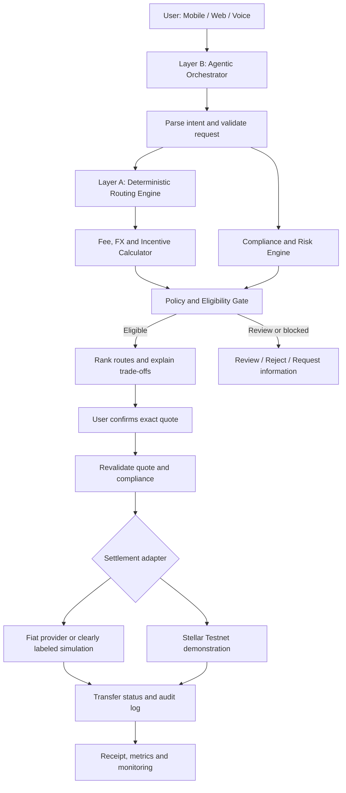

# Borderless Money

> **Agentic, jurisdiction-aware remittance intelligence that maximizes the money that actually arrives.**

**Track:** Idea to Unicorn · **Domain:** FinSphere AI · **Challenge:** Borderless Money
**Default corridor:** 🇦🇪 UAE (AED) → 🇧🇩 Bangladesh (BDT)

## 👥 Team — CTRL V

**Sukonya Dutta Pushpa** (Captain) · Taskif Bin Parves · Wasik Ahmed · Fahim Ahmed · Alisha Akter

---

## 📋 Project Overview

Borderless Money is an agentic remittance orchestrator for the UAE → Bangladesh corridor. Migrant
workers say *“Send 1,000 dirhams to my mother’s bKash in Dhaka”* — and a two-layer AI
system parses the intent, scores every viable payout rail, screens the transaction
against predictive RegTech, explains its decision in plain language, and executes on
the cheapest/fastest compliant route.

### 🌟 The Killer Differentiator: True Net-Receive Optimization

Most apps hide fees and spreads. Borderless Money calculates the **exact amount the recipient
gets** — including the **Bangladesh Bank’s official 2.5% cash incentive** for formal
remittance (Bangladesh Bank, SME & Remittance Department circulars).

```
True Net Receive = (Amount × FX Rate) − (Transfer Fees + Payout Fees)
                 + (Amount × FX Rate × 0.025 Govt Incentive)
```

**Worked example — sending AED 1,000 to bKash (simulated quotes):**

| Route | FX Rate | Total Fees | Govt Incentive (2.5%) | **True Net Receive** | Time |
| :--- | ---: | ---: | ---: | ---: | ---: |
| **Stellar Hybrid Anchor → bKash** ✅ | 32.80 | 4.00 AED | **+820.00 BDT** | **33,488.80 BDT** | 2 h |
| Exchange House MTO → bKash | 32.30 | 12.00 AED | +807.50 BDT | 32,719.90 BDT | 6 h |
| Traditional SWIFT → bKash | 32.40 | 24.00 AED | +810.00 BDT | 32,432.40 BDT | 28 h |

The AI-recommended route delivers **1,056.40 BDT more** than the legacy bank rail —
and the receipt shows exactly why, line by line.

### 🎯 Target Users
1. **Primary:** UAE-based migrant workers (low-literacy, voice-first UX in Bengali / Arabic / English).
2. **Secondary:** Bangladeshi fintechs & mobile money operators (B2B Remittance-as-a-Service API).

---

## 🏗️ Architecture (Two-Layer Agentic Orchestration)

```text
┌─────────────────────────────────────────────────────────────────┐
│                        CLIENT LAYER                              │
│  📱 Web App (Next.js)  │  🎤 Voice (Web Speech API / Whisper)   │
│  📞 USSD Gateway (planned)  │  🔌 B2B RaaS API (REST)           │
└─────────────────────────────────────────────────────────────────┘
                              ▼
┌─────────────────────────────────────────────────────────────────┐
│           LAYER B: AGENTIC ORCHESTRATOR (LangGraph)              │
│  🧠 Intent Parser   →  🔄 Tool Router   →  📝 Explainer           │
│  (plain-text reasoning log for every decision — XAI by default)  │
└─────────────────────────────────────────────────────────────────┘
                              ▼
┌─────────────────────────────────────────────────────────────────┐
│            LAYER A: SCORING & EXECUTION ENGINE (Python)          │
│  📊 Routing Scorer (NetworkX graph search over corridor rails)   │
│  🛡️ Predictive RegTech (GNN risk scoring, PyTorch Geometric)     │
│  ⚖️ Compliance Gate (OFAC fuzzy matching + ISO 20022 mapping)    │
│  💱 FX & Incentive Calc (real-time rate + 2.5% BD Govt incentive)│
└─────────────────────────────────────────────────────────────────┘
                              ▼
┌─────────────────────────────────────────────────────────────────┐
│                   DATA & INTEGRATION LAYER                       │
│  ⛓️ Stellar Horizon (Testnet) │ 🔗 FX feeds │ 📜 OFAC (local)    │
│  🏦 bKash/Nagad mock payout │ 🗄️ PostgreSQL schema + demo store │
└─────────────────────────────────────────────────────────────────┘
```

### Project architecture graph



Full details: [docs/architecture.md](docs/architecture.md)

### Feature Breakdown

| # | Feature | Layer | Status in this repo |
| :--- | :--- | :--- | :--- |
| 1 | **Voice / NL remittance** (low-literacy UX) | Frontend | ✅ Web Speech API + rule-based multilingual intent parser (`intent_parser.py`) |
| 2 | **Two-layer agentic orchestration** | Layer B | ✅ LangGraph graph with deterministic Python tools; sequential fallback when LangGraph isn’t installed |
| 3 | **Predictive RegTech** (pre-settlement GNN risk) | Layer A | ✅ PyTorch Geometric `RemittanceGNN` in repo + deterministic stand-in inference so the demo always works |
| 4 | **Jurisdiction-aware routing + 2.5% incentive math** | Layer A | ✅ NetworkX corridor graph search + `calculate_true_net_receive` |

---

## 📁 Repository Layout

```text
borderless-money/
├── README.md                  ← you are here (project overview)
├── docs/
│   ├── architecture.md        ← layers, data flow, real-vs-simulated
│   ├── api-contracts.md       ← JSON contracts for all endpoints (team contract)
│   ├── demo-script.md         ← the winning 3-minute demo script
│   └── sprint-plan.md         ← 11-day sprint to Oct 31
├── backend/
│   ├── app/
│   │   ├── main.py            ← FastAPI app (RaaS API)
│   │   ├── config.py          ← corridor + demo settings
│   │   ├── agent/
│   │   │   └── orchestrator.py    ← Layer B: LangGraph state machine (+ fallback)
│   │   ├── services/
│   │   │   ├── incentive.py       ← True Net Receive engine (2.5% BD incentive)
│   │   │   ├── routing_scorer.py  ← Layer A: NetworkX corridor graph scorer
│   │   │   ├── intent_parser.py   ← multilingual NL/voice intent extraction
│   │   │   ├── gnn_risk.py        ← Layer A: GNN RegTech (PyG model + stand-in)
│   │   │   ├── compliance.py      ← OFAC fuzzy matching + ISO 20022 mapping
│   │   │   ├── stellar.py         ← Stellar testnet path payment (or simulated)
│   │   │   ├── fx.py              ← FX rate reference data
│   │   │   └── store.py           ← transaction store (memory/SQLite/Postgres schema)
│   │   └── db/
│   │       └── schema.sql         ← PostgreSQL schema (transactions, regtech_logs)
│   ├── data/                  ← FX snapshot, OFAC sample, demo recipients
│   ├── tests/test_core.py     ← runnable with plain python3 (no pytest needed)
│   └── run_demo.py            ← end-to-end happy path in the terminal
└── frontend/                  ← Next.js 14 (TS + Tailwind): voice UI, route
    └── app/ components/ lib/     comparison, compliance panel, receipt
```

---

## 🚀 Quickstart

### Backend (FastAPI)

```bash
cd backend
python3 -m venv .venv && source .venv/bin/activate
pip install -r requirements.txt
uvicorn app.main:app --reload --port 8000
# API docs: http://localhost:8000/docs
```

No time for installs? The core engines are dependency-free — verify them directly:

```bash
python3 backend/tests/test_core.py    # unit tests (stdlib only)
python3 backend/run_demo.py           # full happy path → prints a receipt
```

### Frontend (Next.js)

```bash
cd frontend
npm install
cp .env.local.example .env.local      # points at http://localhost:8000
npm run dev                           # http://localhost:3000
```

Voice input uses the browser `Web Speech API` (Chrome/Edge). A text fallback is
always available.

### Demo scenarios (built in)

| Scenario | What it shows |
| :--- | :--- |
| `default` | Happy path: voice intent → routing with 2.5% incentive → CLEAR compliance → testnet execution → receipt |
| `fuzzy_review` | OFAC near-match (`Nasir Uddin Chowdhury` ≈ `Nasir Uddin Chaudhury`) → held for human review with a plain-language explanation |
| `high_risk` | GNN flags a high-risk graph pattern (new device + new recipient + abnormal amount) → manual review |

Pass `demo_scenario` in `POST /api/agent/execute`, or pick it in the UI.

---

## 🔌 API Summary

| Method | Path | Purpose |
| :--- | :--- | :--- |
| `GET` | `/api/health` | Liveness + available corridors + which optional engines are active |
| `POST` | `/api/agent/parse-intent` | Text/voice transcript → structured intent (en/bn/ar) |
| `POST` | `/api/agent/quote` | Orchestrated quote: intent → ranked routes (True Net Receive) → regulatory citations |
| `POST` | `/api/agent/execute` | Compliance gate → Stellar testnet (or simulated) execution → receipt |
| `GET` | `/api/transactions/{id}` | Fetch a stored transaction receipt |
| `GET` | `/api/routes/compare` | Direct Layer A access: compare routes (`?corridor=uae_bd\|ksa_bd`) |
| `GET` | `/metrics` | Measured KPIs (computed from in-repo eval sets — never invented) |

Full request/response JSON: [docs/api-contracts.md](docs/api-contracts.md)

---

## 🧠 Measured KPIs

`GET /metrics` returns five KPIs computed from this repository — no invented numbers:

| KPI | Measured | How |
| :--- | ---: | :--- |
| Net-receive uplift vs SWIFT | **+3.26%** | corridor math, AED 1,000 (৳33,488.80 vs ৳32,432.40) |
| Intent accuracy (en/bn/ar) | **100%** | 49-utterance curated benchmark (`data/intent_eval.json`) |
| p95 quote latency (engine) | **~1.3 ms** | 20 timed end-to-end quote runs |
| Compliance false-positive hold rate | **0.0%** | 10 labeled clear names (`data/compliance_eval.json`) |
| OFAC screening recall | **100%** | 10 labeled true positives (exact + ≥85% fuzzy) |

Definitions & honesty notes: [docs/kpis.md](docs/kpis.md)

## 🧩 Upgrade highlights (Oct 24)

- **Bangla UI** — `EN | বাংলা` toggle on all four screens, persisted; parser handles Bengali numerals, inflections and Banglish.
- **Config-driven corridors** — `backend/config/corridors/{uae_bd,ksa_bd}.json` hold FX, incentive rate, rails and last-mile fees; a new corridor is a new file, no code changes.
- **Trained GNN behind a flag** — `backend/ml/train_gnn.py` trains the PyG GCN on a labeled synthetic transaction graph (**test AUC 0.9038**, honest eval in `ml/eval.json`); enable with `USE_TRAINED_GNN=true`, else the deterministic stand-in serves. API shape identical.
- **Regulatory RAG** — `backend/rag/` grounds decisions with cited passages from Bangladesh Bank/OFAC/ISO 20022 excerpts; exposed as `regulatory_basis` in every quote/execute response.

---

## ⚖️ Real vs. Simulated (Hackathon Honesty Table)

| Component | Real | Simulated / Mocked |
| :--- | :--- | :--- |
| 2.5% BD Govt incentive math | ✅ real policy, real math | — |
| Routing & fee/FX comparison | ✅ real engine | corridor rates are demo snapshots |
| OFAC screening | ✅ fuzzy-matching engine | sample sanctions list (local JSON) |
| GNN RegTech | ✅ trained PyG GCN shipped (`ml/model.pt`, AUC 0.90 on synthetic benchmark) | stand-in inference is the default; trained model opt-in via `USE_TRAINED_GNN=true` |
| Stellar execution | ✅ testnet code path via `stellar-sdk` | falls back to simulated hash when SDK/keys absent |
| bKash/Nagad payout | — | mock payout registry (`data/recipients.json`) |

Every simulated surface is labeled **"Simulated Quote" / "Testnet Transaction"** in the UI.
The full claim-by-claim contract — including what a real Stellar testnet demo
would require — lives in [REAL_VS_SIMULATED.md](REAL_VS_SIMULATED.md).

## 🧪 One-command verification (judges)

```bash
make smoke           # fresh venv: imports + end-to-end pipeline gate (<60s)
make test            # stdlib unit suite
make eval-sanctions  # sanctions benchmark: true hits BLOCK, near-misses REVIEW, 0% FPR
make eval-rag        # regulatory retrieval hit@2 + citation-domain check
make ablation        # risk-model ablation: rule vs logistic vs boosted vs GCN
make ci-local        # all of the above, CI-equivalent
```

---

## 👥 Team Roles (5 members)

| Role | Primary responsibility | Deliverable by Oct 30 |
| :--- | :--- | :--- |
| **1. AI Orchestrator Lead** | Layer B (LangGraph), intent parsing, tool-calling, explainer | Working orchestrator: voice text → scored tools → explained recommendation |
| **2. RegTech & Data Lead** | Layer A GNN (PyG), OFAC fuzzy matching, ISO 20022 | Risk endpoint returning score + plain-text explanation |
| **3. Routing & Incentive Lead** | Routing scorer (NetworkX), **2.5% incentive math**, FX logic | `calculate_true_net_receive` comparing SWIFT vs Stellar Hybrid |
| **4. Frontend & UX Lead** | Voice UI, route comparison dashboard, receipt | Polished Next.js flow labeling the “Govt Incentive Added” line |
| **5. Backend & Stellar Lead** | FastAPI, DB schema, testnet path payment, deployment | Unified backend + logged testnet transaction |

---

## ⏱️ Sprint Status

Sprint window: **Oct 20 → Oct 31 (11:59 PM GMT+6 submission)** — full plan in
[docs/sprint-plan.md](docs/sprint-plan.md). This repository lands the **Days 1–5
foundation**: monorepo, API contracts, all Layer A engines, the Layer B orchestrator,
the FastAPI shell, the PostgreSQL schema, and the Next.js flow. Days 6–7
(integration) are mostly wiring that already exists here end-to-end.

## 🎬 Demo & competition

The rubric-aligned 3-minute video script is in [docs/demo-script.md](docs/demo-script.md).
Competition mapping against the AI Builders Congress (verified judging criteria, gap
analysis, advisory review): [docs/competition-analysis.md](docs/competition-analysis.md).
One-pager: [docs/one-pager.md](docs/one-pager.md) · Submission week plan:
[docs/submission-plan.md](docs/submission-plan.md) · KPIs: [docs/kpis.md](docs/kpis.md).

---

### ⚠️ Disclaimer

Borderless Money is a hackathon prototype. Quotes are simulated snapshots, blockchain settlement
runs on the **Stellar testnet**, and payout rails are mocked. It is not a licensed
money-services business — yet. PII stays off-chain; only hashes and non-identifying
audit data touch the ledger.
