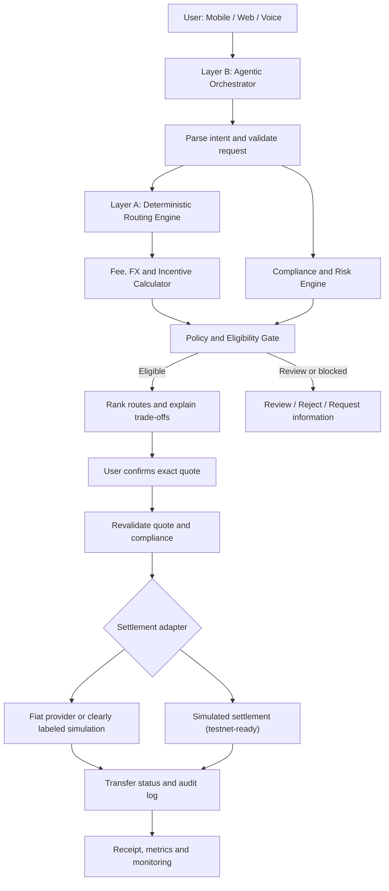

<p align="center">
  
</p>
<h1 align="center">xPay</h1>

> **Agentic, jurisdiction-aware remittance intelligence that maximizes the money that actually arrives.**

**Track:** Idea to Unicorn · **Domain:** FinSphere AI · **Challenge:** Borderless Money
**Default corridor:** 🇦🇪 UAE (AED) → 🇧🇩 Bangladesh (BDT)

## 👥 Team — CTRL V

**Sukonya Dutta Pushpa** (Captain) · Taskif Bin Parves · Wasik Ahmed · Fahim Ahmed · Alisha Akter

---

## 📋 Project Overview

xPay is an agentic remittance orchestrator for the UAE → Bangladesh corridor. Migrant
workers say *“Send 1,000 dirhams to my mother’s bKash in Dhaka”* — and a two-layer AI
system parses the intent, scores every viable payout rail, screens the transaction
against predictive RegTech, explains its decision in plain language, and executes on
the cheapest/fastest compliant route.

**Product positioning:** a **B2B Remittance-Intelligence API** with a user-facing
demonstration app — *"help remittance providers and fintech platforms compare eligible
transfer routes, maximize the recipient's net amount, understand compliance restrictions,
and explain every recommendation using traceable evidence."* Business model, ROI model
(unit-tested, frontend calculator at `/roi`) and validation plan:
[docs/PRODUCT_STRATEGY.md](docs/PRODUCT_STRATEGY.md).

### Execution safety (quote lifecycle)

Every quote is a persisted artifact (`quote_id` + expiry). Execution **binds** to the
confirmed quote: expired, consumed, mismatched or unconfirmed quotes are refused; the
receipt uses the quoted numbers verbatim; `Idempotency-Key` makes retries safe; and an
injected settlement `TIMEOUT` is reported as `RECONCILIATION_REQUIRED` — never as
success. All math is exact-decimal (`docs/FINANCIAL_MODEL.md`); routes with missing
pricing are flagged and can never win or settle.

### 🌟 The Killer Differentiator: True Net-Receive Optimization

Most apps hide fees and spreads. xPay calculates the **exact amount the recipient
gets** — including the **Bangladesh Bank’s official 2.5% cash incentive** for formal
remittance (Bangladesh Bank, SME & Remittance Department circulars). Every term below is
in BDT: fees quoted in AED are converted at the same rate before they are subtracted —
that is how the engine computes it (`app/services/incentive.py`, contract in
[docs/FINANCIAL_MODEL.md](docs/FINANCIAL_MODEL.md)).

$$
\begin{aligned}
\text{Gross}_{BDT}&=\text{Principal}_{AED}\times\text{FX}\\
\text{Fees}_{BDT}&=\text{Fees}_{AED}\times\text{FX}\\
\text{Net}_{BDT}&=\text{Gross}_{BDT}-\text{Fees}_{BDT}\\
&\quad+\text{Eligible incentive}_{BDT}
\end{aligned}
$$

The incentive is **not assumed for every transfer**: it is computed per route under the
applicable policy — the Bangladesh Bank cash incentive applies to qualifying
formal-channel remittance, so it is added only on rails flagged `incentive_eligible`
(see the incentive-eligibility flag in `backend/config/corridors/uae_bd.json` —
the ineligible Cash Pickup rail earns 0 even with the best headline FX).

**Worked example — sending AED 1,000 to bKash through xPay (simulated quotes):**

| Route | FX Rate | Total Fees | Govt Incentive (2.5%) | **True Net Receive** | Time |
| :--- | ---: | ---: | ---: | ---: | ---: |
| **Stellar Hybrid Anchor → bKash** ✅ | 32.80 | 6.00 AED *(3.00 rail + 1.00 last-mile + **2.00 xPay fee**)* | **+820.00 BDT** | **33,423.20 BDT** | 2 h |
| Exchange House MTO → bKash | 32.30 | 14.00 AED *(incl. 2.00 xPay fee)* | +807.50 BDT | 32,655.30 BDT | 6 h |
| Traditional SWIFT → bKash (via xPay) | 32.40 | 26.00 AED *(incl. 2.00 xPay fee)* | +810.00 BDT | 32,367.60 BDT | 28 h |
| *Legacy counterfactual: Traditional SWIFT sent outside xPay* | 32.40 | 24.00 AED | +810.00 BDT | 32,432.40 BDT | 28 h |

The AI-recommended route delivers **990.80 BDT more (+3.05%)** than the legacy bank rail —
after xPay's own AED 2.00 sender fee is paid —
and the receipt shows exactly why, line by line.

### 🎯 Target Users
1. **Primary:** UAE-based migrant workers (low-literacy, voice-first UX in Bengali / Arabic / English).
2. **Secondary:** Bangladeshi fintechs & mobile money operators (B2B Remittance-as-a-Service API).

---

## 🏗️ Architecture (Two-Layer Agentic Orchestration)

```text
┌─────────────────────────────────────────────────────────────────┐
│                        CLIENT LAYER                              │
│  📱 Web App (Next.js)  │  🎤 Voice (Web Speech API / Whisper)   │
│  📞 USSD Gateway (planned)  │  🔌 B2B RaaS API (REST)           │
└─────────────────────────────────────────────────────────────────┘
                              ▼
┌─────────────────────────────────────────────────────────────────┐
│           LAYER B: AGENTIC ORCHESTRATOR (LangGraph)              │
│  🧠 Intent Parser   →  🔄 Tool Router   →  📝 Explainer           │
│  (plain-text reasoning log for every decision — XAI by default)  │
└─────────────────────────────────────────────────────────────────┘
                              ▼
┌─────────────────────────────────────────────────────────────────┐
│            LAYER A: SCORING & EXECUTION ENGINE (Python)          │
│  📊 Routing Scorer (rail pricing: EV ranking + incentive gate)   │
│  🛡️ Predictive RegTech (GNN risk scoring, PyTorch Geometric)     │
│  ⚖️ Compliance Gate (OFAC fuzzy matching + ISO 20022 mapping)    │
│  💱 FX & Incentive Calc (snapshot rate + 2.5% BD Govt incentive) │
└─────────────────────────────────────────────────────────────────┘
                              ▼
┌─────────────────────────────────────────────────────────────────┐
│                   DATA & INTEGRATION LAYER                       │
│  ⛓️ Horizon testnet probe     │ 🔗 FX feeds │ 📜 OFAC (local)    │
│  🏦 bKash/Nagad mock payout │ 🗄️ PostgreSQL schema + demo store │
└─────────────────────────────────────────────────────────────────┘
```

### Project architecture graph



Full details: [docs/architecture.md](docs/architecture.md)

### Feature Breakdown

| # | Feature | Layer | Status in this repo |
| :--- | :--- | :--- | :--- |
| 1 | **Voice / NL remittance** (low-literacy UX) | Frontend | ✅ Web Speech API + rule-based multilingual intent parser (`intent_parser.py`) |
| 2 | **Two-layer agentic orchestration** | Layer B | ✅ LangGraph graph with deterministic Python tools; sequential fallback when LangGraph isn’t installed |
| 3 | **Predictive RegTech** (pre-settlement GNN risk) | Layer A | ✅ PyTorch Geometric `RemittanceGNN` in repo + deterministic stand-in inference so the demo always works |
| 4 | **Jurisdiction-aware routing + 2.5% incentive math** | Layer A | ✅ Corridor rail pricing + `calculate_true_net_receive`; incentive eligibility is routing logic; ranked by expected value with a naive cheapest-fee baseline |

---

## 📁 Repository Layout

```text
xpay/
├── README.md                  ← you are here (project overview)
├── docs/
│   ├── architecture.md        ← layers, data flow, real-vs-simulated
│   ├── api-contracts.md       ← JSON contracts for all endpoints (team contract)
│   ├── demo-script.md         ← the winning 3-minute demo script
│   └── sprint-plan.md         ← 11-day sprint to Oct 31
├── backend/
│   ├── app/
│   │   ├── main.py            ← FastAPI app (RaaS API) incl. GET /metrics
│   │   ├── config.py          ← corridor + demo settings (from corridor config)
│   │   ├── agent/
│   │   │   └── orchestrator.py    ← Layer B: LangGraph state machine (+ fallback)
│   │   ├── services/
│   │   │   ├── incentive.py       ← True Net Receive engine (2.5% BD incentive)
│   │   │   ├── routing_scorer.py  ← corridor rail pricing: EV ranking, incentive
│   │   │   │                        eligibility, deadline filter, naive baseline
│   │   │   ├── corridor.py        ← loads config/corridors/*.json (rules as data)
│   │   │   ├── intent_parser.py   ← multilingual NL/voice intent extraction
│   │   │   ├── gnn_risk.py        ← risk scoring: trained GCN flag + stand-in,
│   │   │   │                        decision-log explanations
│   │   │   ├── compliance.py      ← sanctions matcher v2 (normalized Jaro +
│   │   │   │                        coverage, rationale) + pacs.008 subset
│   │   │   ├── llm.py             ← bounded LLM access (schema-validated, off
│   │   │   │                        by default)
│   │   │   ├── explainer.py       ← grounded en/bn explanations (number guard)
│   │   │   ├── regulatory_rag.py  ← cited regulatory retrieval (MiniLM or
│   │   │   │                        lexical fallback)
│   │   │   ├── horizon.py         ← live Stellar Horizon reachability probe
│   │   │   ├── stellar.py         ← settlement — SIMULATED by design
│   │   │   ├── metrics.py         ← GET /metrics: measured KPIs from eval sets
│   │   │   └── store.py           ← transaction store (memory/SQLite)
│   │   └── db/
│   │       └── schema.sql         ← PostgreSQL schema (production store)
│   ├── config/corridors/      ← uae_bd.json + ksa_bd.json (rules as data)
│   ├── data/                  ← FX snapshot, OFAC sample + eval sets, recipients
│   ├── rag/corpus/            ← BB / OFAC / ISO 20022 excerpts (cited chunks)
│   ├── ml/                    ← train_gnn.py + ablation.py + model.pt + evals
│   ├── evals/                 ← eval_sanctions.py, eval_rag.py (make targets)
│   ├── tests/                 ← test_core, test_smoke, test_step3, test_step4
│   ├── Dockerfile             ← full-system backend image
│   ├── requirements-{full,lite}.txt
│   └── run_demo.py            ← end-to-end happy path in the terminal
├── frontend/                  ← Next.js 14 (TS + Tailwind): 4-screen flow,
│   └── app/ components/ lib/     Bangla toggle, mic, blockchain trail
├── docker-compose.yml         ← backend + frontend, `docker compose up --build`
├── Makefile                   ← smoke / test / evals / ablation / docker targets
├── .github/workflows/ci.yml   ← fresh-checkout CI (tests + docker image)
└── REAL_VS_SIMULATED.md       ← claim-by-claim truth table
```

---

## 🚀 Quickstart

### Docker (full system — recommended)

```bash
docker compose up --build
# backend  → http://localhost:8000  (API docs at /docs)
# frontend → http://localhost:3000
```

The backend image installs the **full** stack (LangGraph, PyG risk model,
embeddings) from `backend/requirements-full.txt`. Just the backend image:

```bash
docker build -t xpay-backend -f backend/Dockerfile backend
docker run -p 8000:8000 xpay-backend
```

Verified: the image builds, boots in ~10 s, and serves the exact demo numbers
(৳33,423.20) — see [REAL_VS_SIMULATED.md](REAL_VS_SIMULATED.md).

### Backend (FastAPI, local venv)

```bash
cd backend
python3 -m venv .venv && source .venv/bin/activate
pip install -r requirements-full.txt   # or requirements-lite.txt for the fast path
uvicorn app.main:app --reload --port 8000
# API docs: http://localhost:8000/docs
```

No time for installs? The core engines are dependency-free — verify them directly:

```bash
python3 backend/tests/test_core.py    # unit tests (stdlib only)
python3 backend/run_demo.py           # full happy path → prints a receipt
```

### Frontend (Next.js)

```bash
cd frontend
npm install
cp .env.local.example .env.local      # points at http://localhost:8000
npm run dev                           # http://localhost:3000
```

Voice input uses the browser `Web Speech API` (Chrome/Edge). A text fallback is
always available.

### Demo scenarios (built in)

| Scenario | What it shows |
| :--- | :--- |
| `default` | Happy path: voice intent → routing with 2.5% incentive → CLEAR compliance → simulated settlement (clearly labeled) → receipt |
| `fuzzy_review` | OFAC near-match (`Nasir Uddin Chowdhury` ≈ `Nasir Uddin Chaudhury`) → held for human review with a plain-language explanation |
| `high_risk` | GNN flags a high-risk graph pattern (new device + new recipient + abnormal amount) → manual review |

Pass `demo_scenario` in `POST /api/agent/execute`, or pick it in the UI.

---

## 🔌 API Summary

| Method | Path | Purpose |
| :--- | :--- | :--- |
| `GET` | `/api/health` | Liveness + available corridors + which optional engines are active |
| `GET` | `/api/ready` | Readiness: config + store checks |
| `POST` | `/api/agent/parse-intent` | Text/voice transcript → structured intent (en/bn/ar) |
| `POST` | `/api/agent/quote` | Orchestrated quote: intent → ranked routes (True Net Receive) → regulatory citations → **persisted quote_id** |
| `POST` | `/api/agent/execute` | Compliance gate → quote binding/revalidation → execution → receipt. `Idempotency-Key` honored |
| `GET` | `/api/transactions/{id}` | Fetch a stored transaction receipt |
| `GET` | `/api/quotes/{quote_id}` | Quote details with live status (`ACTIVE`/`EXPIRED`/`CONSUMED`) |
| `GET` | `/api/routes/compare` | Direct Layer A access: compare routes (`?corridor=uae_bd\|ksa_bd`) |
| `GET` | `/metrics` | Measured KPIs (computed from in-repo eval sets — never invented) |

Cross-cutting: `X-Request-ID` on every response · per-IP rate limiting on `/api/*`
(ops probes exempt) · optional API-key enforcement (`XPAY_API_KEY`).
Full request/response JSON: [docs/api-contracts.md](docs/api-contracts.md)

---

## 🧠 Measured KPIs

`GET /metrics` returns five KPIs computed from this repository — no invented numbers:

| KPI | Measured | How |
| :--- | ---: | :--- |
| Net-receive uplift vs SWIFT | **+3.05%** | corridor math, AED 1,000 (৳33,423.20 best route incl. xPay's AED 2 fee vs ৳32,432.40 legacy SWIFT) |
| Intent accuracy (en/bn/ar) | **100%** | 49-utterance curated benchmark (`data/intent_eval.json`) |
| p95 quote latency (engine) | **~2–3 ms** | 20 timed in-process quote runs — live value at `GET /metrics` |
| Compliance false-positive hold rate | **0.0%** | 21 labeled clear names (`data/sanctions_eval.json`) |
| OFAC screening recall | **100%** | 11 labeled true positives (exact/leet after normalization; alias-only matches are held for review, not blocked) (`data/sanctions_eval.json`) |

Definitions & honesty notes: [docs/kpis.md](docs/kpis.md)

## 🧩 Upgrade highlights (Oct 25 — B2B + financial-integrity pass)

- **Exact-decimal money engine** — all monetary arithmetic in `Decimal` (`services/money.py`); half-up rounding at display edges, exact `*_exact` strings in every breakdown, NaN/garbage rejected, missing fees flagged (never zeroed) and such routes barred from winning *and* settling.
- **Quote lifecycle** — persisted quotes with TTL; execution binds to the confirmed quote (expired/consumed/mismatched/unconfirmed refused); `Idempotency-Key` retries; injected settlement timeouts surface as `RECONCILIATION_REQUIRED`, never fake success.
- **B2B layer** — ROI engine + `/roi` calculator (hand-computed tests), product strategy, business-validation kit with an EMPTY (non-invented) results log: [docs/PRODUCT_STRATEGY.md](docs/PRODUCT_STRATEGY.md).
- **API hardening** — `X-Request-ID` tracing, per-IP rate limiting, optional `X-API-Key`, `/api/ready`, structured quote-binding error codes (verified over live HTTP).
- **Scenario evaluation A–H** — the product tested like a judge: adaptive re-ranking, expired quotes, compliance holds, provider failures, uncertain settlement, adversarial input, Bengali/Banglish. Report: [docs/evaluation_report.json](docs/evaluation_report.json).
- **Screening fix** — bare recipient names in free text are now extracted and screened instead of being silently replaced by the demo persona.

## 🧩 Upgrade highlights (Oct 24)

- **Bangla UI** — `EN | বাংলা` toggle on all four screens, persisted; parser handles Bengali numerals, inflections and Banglish.
- **Config-driven corridors** — `backend/config/corridors/{uae_bd,ksa_bd}.json` hold FX, incentive rate, rails and last-mile fees; a new corridor is a new file, no code changes.
- **Trained GNN behind a flag** — `backend/ml/train_gnn.py` trains the PyG GCN on a labeled **synthetic** transaction graph (held-out AUC 0.9038 — *prototype evidence of the training pipeline, not evidence of production fraud detection*). Class-specific error analysis in `ml/eval.json` shows the trained model's raw scores never reach the 0.8 production review gate (recall 0.0 at that threshold), and `ml/ablation.md` shows a simple linear rule matches the GCN on the same split — so the deterministic stand-in stays the default; `USE_TRAINED_GNN=true` is opt-in and needs recalibration before any review-triggering use. API shape identical.
- **Regulatory RAG** — `backend/rag/` grounds decisions with cited passages from Bangladesh Bank/OFAC/ISO 20022 excerpts; exposed as `regulatory_basis` in every quote/execute response.

---

## ⚖️ Real vs. Simulated (Hackathon Honesty Table)

| Component | Real | Simulated / Mocked |
| :--- | :--- | :--- |
| 2.5% BD Govt incentive math | ✅ real policy, real math | — |
| Routing & fee/FX comparison | ✅ real engine | corridor rates are demo snapshots |
| OFAC screening | ✅ fuzzy-matching engine | sample sanctions list (local JSON) |
| GNN RegTech | ✅ trained PyG GCN shipped (`ml/model.pt`); held-out **synthetic** benchmark AUC 0.9038 with class-error analysis + baseline ablation published — labeled prototype evidence, not production effectiveness (at the 0.8 policy gate the trained model flags nothing: recall 0.0; a linear rule matches its AUC) | stand-in inference is the default; trained model opt-in via `USE_TRAINED_GNN=true` |
| Stellar execution | ✅ deterministic simulated settlement, clearly labeled (`simulated: true`, `network: "SIMULATED"`) | testnet path payment is NOT implemented — a real demo needs funded issuer/distributor + trustlines (see REAL_VS_SIMULATED.md) |
| bKash/Nagad payout | — | mock payout registry (`data/recipients.json`) |

Every simulated surface is labeled **Simulated** in the UI (the receipt's chain trail shows `network: SIMULATED`).
The full claim-by-claim contract — including what a real Stellar testnet demo
would require — lives in [REAL_VS_SIMULATED.md](REAL_VS_SIMULATED.md).

## 🧪 One-command verification (judges)

```bash
make smoke            # fresh venv: imports + end-to-end pipeline gate (<60s)
make test             # stdlib unit suites: core + financial edge cases + ROI model
make test-financial   # money math / eligibility / quote-lifecycle edge cases
make test-roi         # ROI model vs hand-computed values
make eval-sanctions   # sanctions benchmark: true hits BLOCK, near-misses REVIEW, 0% FPR
make eval-rag         # regulatory retrieval hit@2 + citation-domain check
make scenarios        # end-to-end scenarios A–H → docs/evaluation_report.json
make ablation         # risk-model ablation: rule vs logistic vs boosted vs GCN
make ci-local         # all of the above, CI-equivalent
```

Scenario results live in [docs/evaluation_report.json](docs/evaluation_report.json)
(generated by `make scenarios` — machine-readable, timestamped, with data-type labels).

Repo integrity: `git ls-files | grep routing_scorer` → committed (the reviewer's
export tool parsed 41 of 67 files; nothing was missing from the repo itself —
`git clone` + `make setup && make smoke` passes, and `docker compose up --build`
runs the full system, verified).

---

## 👥 Team Roles (5 members)

| Role | Primary responsibility | Deliverable by Oct 30 |
| :--- | :--- | :--- |
| **1. AI Orchestrator Lead** | Layer B (LangGraph), intent parsing, tool-calling, explainer | Working orchestrator: voice text → scored tools → explained recommendation |
| **2. RegTech & Data Lead** | Layer A GNN (PyG), OFAC fuzzy matching, ISO 20022 | Risk endpoint returning score + plain-text explanation |
| **3. Routing & Incentive Lead** | Routing scorer (incentive eligibility, EV ranking), **2.5% incentive math**, FX logic | `calculate_true_net_receive` comparing SWIFT vs Stellar Hybrid |
| **4. Frontend & UX Lead** | Voice UI, route comparison dashboard, receipt | Polished Next.js flow labeling the “Govt Incentive Added” line |
| **5. Backend & Stellar Lead** | FastAPI, DB schema, settlement adapter, deployment | Unified backend + labeled simulated settlement receipt |

---

## ⏱️ Sprint Status

Sprint window: **Oct 20 → Oct 31 (11:59 PM GMT+6 submission)** — full plan in
[docs/sprint-plan.md](docs/sprint-plan.md). This repository lands the **Days 1–5
foundation**: monorepo, API contracts, all Layer A engines, the Layer B orchestrator,
the FastAPI shell, the PostgreSQL schema, and the Next.js flow. Days 6–7
(integration) are mostly wiring that already exists here end-to-end.

## 🎬 Demo & competition

The rubric-aligned 3-minute video script is in [docs/demo-script.md](docs/demo-script.md).
Competition mapping against the AI Builders Congress (verified judging criteria, gap
analysis, advisory review): [docs/competition-analysis.md](docs/competition-analysis.md).
One-pager: [docs/one-pager.md](docs/one-pager.md) · Submission week plan:
[docs/submission-plan.md](docs/submission-plan.md) · KPIs: [docs/kpis.md](docs/kpis.md).

**New documentation (Oct 25):** financial calculation contract
([FINANCIAL_MODEL](docs/FINANCIAL_MODEL.md)) · product strategy & ROI
([PRODUCT_STRATEGY](docs/PRODUCT_STRATEGY.md)) · customer-discovery kit
([business-validation](docs/business-validation.md)) · threat model &
responsible-AI limits ([SECURITY_AND_RESPONSIBLE_AI](docs/SECURITY_AND_RESPONSIBLE_AI.md))
· what was actually run ([VALIDATION_REPORT](docs/VALIDATION_REPORT.md)).

---

### ⚠️ Disclaimer

xPay is a hackathon prototype. Quotes are simulated snapshots, blockchain settlement is
**simulated by design** (testnet-ready adapter, clearly labeled — never presented as a
real ledger transaction), and payout rails are mocked. It is not a licensed
money-services business — yet. PII stays off-chain; only hashes and non-identifying
audit data touch the ledger. Responsible-AI statement:
[docs/responsible-ai.md](docs/responsible-ai.md).
